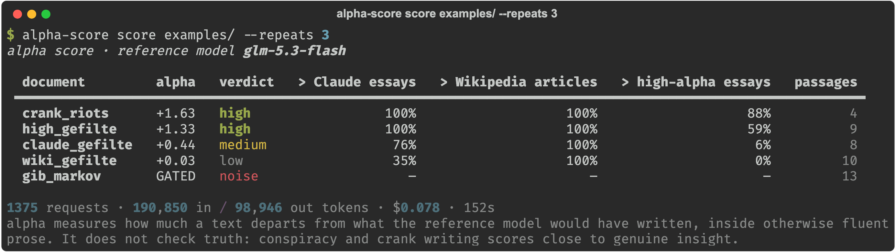
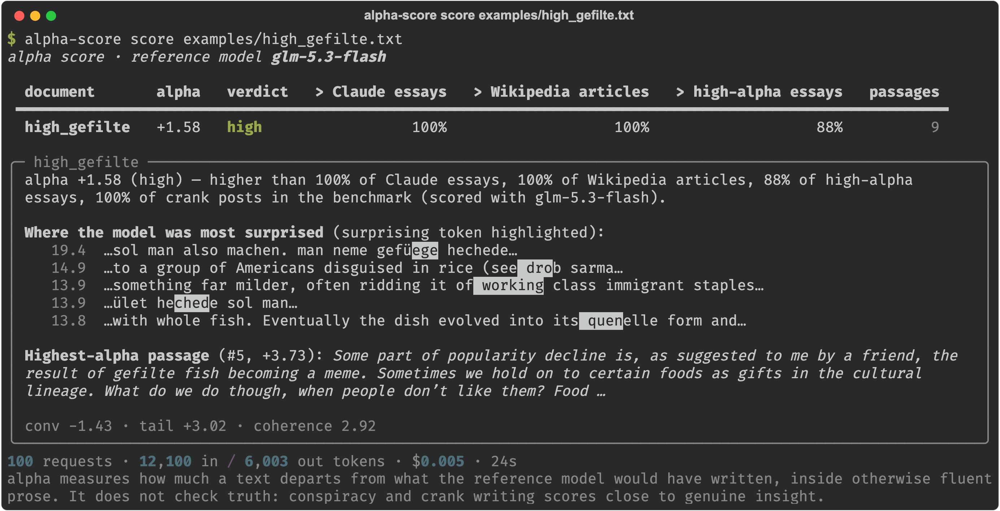
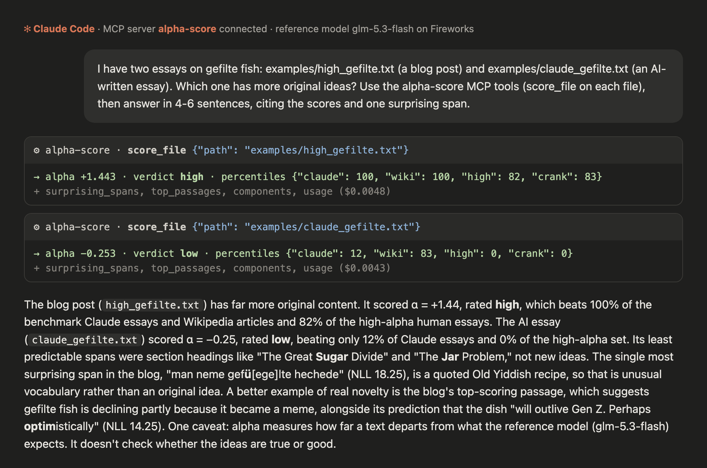

# alpha-score

**How much genuinely new content does a text have?** alpha-score measures "alpha": ideas a strong language model
would not have written itself, delivered in otherwise fluent prose. It uses only token log-probabilities from an
open-weights reference model. There is no LLM judge, no training and no labels. It works as a **CLI**, a
**Python library**, or an **MCP server** for Claude, Cursor and other agents. All you need is a
[Fireworks](https://fireworks.ai) API key, and a scored essay costs about a cent.



Five texts, mostly on one topic (gefilte fish), averaged over 3 runs. The human blog post rates **high**, ahead of
Claude's essay (medium) and the Wikipedia article (low), and the bigram gibberish is rejected outright. The conspiracy
post scores highest of all. That is the main limitation: **alpha measures novelty, not truth** (see
[Limitations](docs/HOW_IT_WORKS.md#limitations)).

## Quick start

```bash
git clone <this repo> && cd alpha-score
pip install -e .                       # Python 3.11+; installs the `alpha-score` and `alpha-score-mcp` commands
export FIREWORKS_API_KEY=fw_...        # https://fireworks.ai/account/api-keys

alpha-score score examples/            # rank every .txt/.md in a folder
alpha-score score essay.md             # one document, with an explanation
pbpaste | alpha-score score -          # stdin
alpha-score score essay.md --json      # full machine-readable report
```

One document gets a detailed view. It shows where the score falls among benchmark texts, where the model was most
surprised, and the highest-alpha passage:



## Use it from Claude (MCP)

```bash
claude mcp add alpha-score -e FIREWORKS_API_KEY=fw_... -- alpha-score-mcp
```

Then ask, for example, *"Which of these drafts has more original ideas?"*. Tools: `score_text`, `compare_texts`,
`score_file`, `list_models`, `check_setup`. [docs/MCP.md](docs/MCP.md) has the Claude Desktop, Cursor and `.mcp.json`
setups.



## Use it from Python

```python
from alpha_score import Scorer, explain

sc = Scorer()                                   # reads FIREWORKS_API_KEY / config file
r = sc.score_text(open("essay.md").read(), title="essay")
print(explain(r))       # alpha +1.44 (high) — higher than 100% of Claude essays, 100% of Wikipedia articles, ...
r["surprising_spans"]   # where the model was most surprised
sc.score_texts({"draft A": a, "draft B": b})   # ranked
sc.cost()               # {'prompt_tokens': ..., 'completion_tokens': ..., 'usd': 0.0048}
```

## How it works (short version)

For each ~100-word passage, the reference model
1. reads the real text and records how surprised it is by each token;
2. writes **6 continuations of its own** from the same 32-token start;
3. compares the two. **Alpha** is high when the text's typical words are as predictable as the model's own writing
   (*a conventional core*) but its most surprising 10% are far more surprising than anything the model wrote itself
   (*an atypical tail*). This is the pattern Uzzi et al. (2013) found in the most impactful science.

A shuffled-word **coherence gate** rejects gibberish, which would otherwise look maximally surprising.
[docs/HOW_IT_WORKS.md](docs/HOW_IT_WORKS.md) covers the full method, how to read a score, the voice-vs-ideas
control, the benchmark, noise and limitations.

**Does it just detect AI writing?** No. Claude rewrote high-alpha human essays in its own voice, keeping the ideas,
and they kept their high scores. Claude's own essays rewritten in the human authors' voices stayed low. On the
default model the content effect is +1.48 SD and the voice effect +0.03 SD.

## Benchmark

There are 50 documents: 17 high-taste human essays (3 blog posts + 14 Atlantic essays published after the models'
training cutoff), 17 Claude essays on the same titles, 6 Wikipedia articles, 6 crank posts and 4 gibberish texts.
AUROC is the chance a random high-alpha essay outscores a random document of the other class.

| reference model | vs Wikipedia | vs Claude | vs crank | vs all | gibberish gated | access |
|---|---|---|---|---|---|---|
| **GLM-5.3-Flash** (default) | 1.00 | 0.96 | 0.67 | **0.92** | 4/4 | Fireworks pay-per-token |
| Qwen2.5-72B base | 0.99 | 0.87 | 0.66 | 0.87 | 4/4 | dedicated GPUs (`--deploy` or Modal) |
| Qwen2.5-72B instruct | 0.86 | 0.93 | 0.65 | 0.87 | 4/4 | dedicated GPUs |

No real document is wrongly gated on any of these. Full results are in [eval/RESULTS.md](eval/RESULTS.md); rebuild
them with `python eval/regenerate.py`.

**Noise:** a document's score moves by about ±0.25 between runs (SD 0.26; the self-samples are random). Rankings
across classes hold up: a second full run gave AUROC 0.93. Treat texts within about 0.5 of each other as tied, or
use `--repeats 2`. [Details](docs/HOW_IT_WORKS.md#run-to-run-noise).

## Configuration

Settings are resolved in this order: CLI flags, then environment variables, then a config file
(`./alpha-score.toml` or `~/.config/alpha-score/config.toml`), then defaults. `alpha-score config` shows the result.
See [`alpha-score.example.toml`](alpha-score.example.toml).

| setting | env var | default |
|---|---|---|
| API key | `FIREWORKS_API_KEY` (or whatever `api_key_env` names) | required |
| `model` | `ALPHA_SCORE_MODEL` | `glm-5.3-flash` (`alpha-score models` lists all) |
| `provider` | `ALPHA_SCORE_PROVIDER` | `fireworks`; `openai` = any OpenAI-compatible server with echo + logprobs, e.g. `vllm serve` |
| `base_url` | `ALPHA_SCORE_BASE_URL` | for `provider = "openai"` |
| `workers` | `ALPHA_SCORE_WORKERS` | 16 concurrent requests |
| `max_passages` | `ALPHA_SCORE_MAX_PASSAGES` | 20 (about 2,000 words per document) |
| `repeats` | `ALPHA_SCORE_REPEATS` | 1; average N self-sample draws for less noise at N× cost |
| `deployment`, `account_id` | `ALPHA_SCORE_DEPLOYMENT`, `FIREWORKS_ACCOUNT_ID` | dedicated Fireworks deployments only |

**Other reference models.** Base models such as Qwen2.5-72B aren't served pay-per-token anywhere. Options:
- `alpha-score score essays/ --model qwen2.5-72b --deploy` creates a temporary Fireworks deployment, scores, and
  always deletes it (about $8/GPU-hour, billed per second).
- `alpha-score deploy` keeps a deployment up for several runs.
- `scripts/modal_backend.py` runs vLLM on your own Modal GPUs.

Why not OpenAI, Anthropic or OpenRouter? None of them return log-probabilities for text you supply, only for text
the model generates ([details](docs/HOW_IT_WORKS.md#why-it-needs-prompt-token-log-probabilities)).

## Repository

| path | |
|---|---|
| `src/alpha_score/core.py` | the statistic, gate and aggregation (pure Python) |
| `src/alpha_score/client.py` | OpenAI-compatible client: echo logprobs, self-samples, usage tracking |
| `src/alpha_score/scorer.py` | `Scorer`: reports, verdicts, percentiles, surprising spans, temporary deployments |
| `src/alpha_score/fireworks.py` | Fireworks endpoints and the deployment lifecycle |
| `src/alpha_score/models.py`, `calibration.json` | reference-model registry and benchmark score distributions |
| `src/alpha_score/cli.py`, `mcp_server.py`, `config.py` | CLI, MCP server, configuration |
| `examples/` | five texts: a human blog post, Claude essay and Wikipedia article on gefilte fish, a crank post, gibberish |
| `eval/` | benchmark passages, scored outputs (6 models plus a GLM re-run), `evaluate.py`, `regenerate.py`, `RESULTS.md` |
| `verify/` | API-vs-native-vLLM verification and provider test notes (`VERIFY.md`) |
| `scripts/` | `modal_backend.py` (own GPUs), `build_calibration.py` |
| `docs/` | method, MCP setup, screenshots (`make_screenshots.py` regenerates them from live runs) |
| `tests/` | `test_offline.py` (no key needed: `pytest`), `mcp_smoke.py` (live, ~$0.01) |

## License

[PolyForm Noncommercial 1.0.0](LICENSE): free for any noncommercial use (personal, research, education, nonprofits). For commercial use, contact Fergana Labs. The benchmark and example texts belong to their authors; see [DATA.md](DATA.md).
